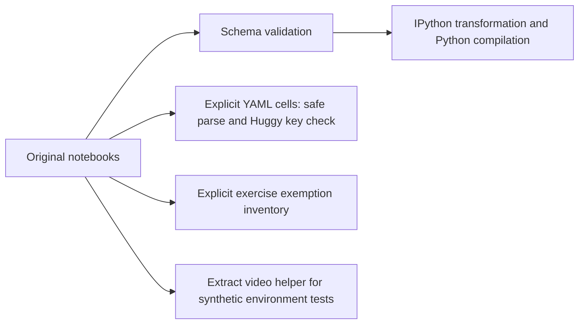

# Design and maintenance

## Source and validation flow

`scripts/check_notebooks.py` finds notebook files under `notebooks/`. It preserves their original schema and bytes. Code-cell `metadata.id` is the exemption identity, not the positional cell number or the notebook format's separate cell id. A duplicate metadata ID in one notebook is rejected so a single exercise exemption cannot excuse two cells. Ordinary code cells may lack that metadata ID. Exercise IDs count only when compilation actually fails; a completed exercise still listed as exempt is an error. YAML validation checks structure and the Huggy behavior key, not every ML-Agents runtime constraint.

The checker prints counts and raises on validation errors. It does not create a model or report learning performance. There is no supported service/API/config environment for this repository. The Python scripts are offline validation entry points; notebooks remain educational workflows requiring separate environment review.

## Maintenance and recovery

Use validation dependencies from `requirements-ci.txt` (nbformat, IPython, PyYAML); Python 3.10/3.12 compatibility is tested in CI. The lock pins direct validation tools but is not a complete hashed training environment. Keep course attribution, notebook contents and known exercises; do not silently fill student work to make checks pass. After a notebook edit rerun schema/compilation and unit checks. Diagnose the exact notebook/cell identity from the exception before adjusting the inventory.

Tests use temporary notebooks and mocked video writers/environments. A passing test establishes helper/checker behavior only. It does not verify numerical convergence, package installation in Colab, GPU/Unity compatibility or remote Hub publication.

## Data and release contract

Notebook source is versioned. Learned weights, videos, downloaded environments and Q-tables are outputs of separately executed workflows; they have no delivery/quality contract here. Preserve provenance and never publish private credentials embedded in cell outputs. Version is declared by `VERSION`; the dated [release review](RELEASE_REVIEW.md) is historical evidence. Update version/review when behavior changes; documentation corrections do not imply a new training/model release.

The local docs checker validates inline repository links/heading anchors, skips fenced examples and external URLs, and does not execute snippets or verify external availability. Vendored/reference course content is not upgraded to a production architecture by this guide.
